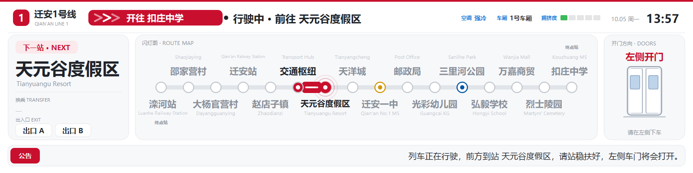
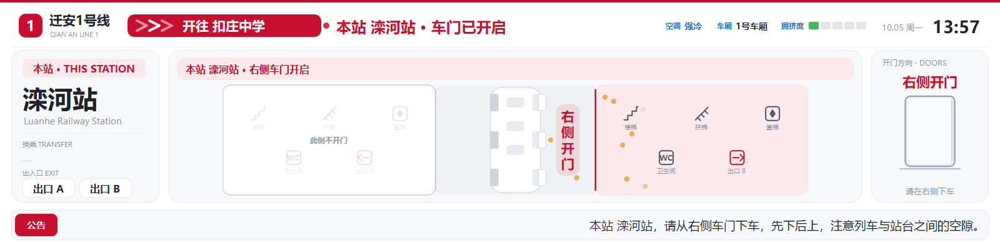
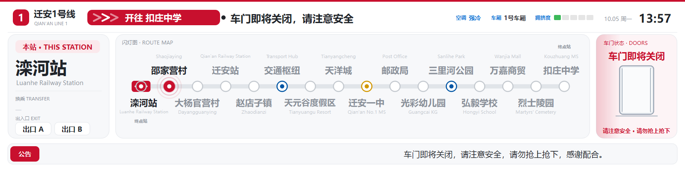
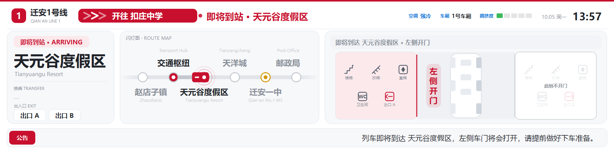

# 地铁 LCD 报站屏模拟 · 迁安1号线

> 用 **C++ / Qt 6** 手绘的一个「地铁车门上方横条屏」模拟——就是国内地铁里那种 4:1 的超宽信息带：
> 闪灯图、下一站、开门侧、站台布局、滚动公告、车厢拥挤度/空调，还带**中英双语报站语音**。
> 线路、站名、换乘、出入口全部写在 `assets/line.json` 里，**改配置就能换线路，不用碰 C++ 代码**。




> **说明**：`迁安1号线` 是**虚构线路**（迁安目前没有地铁），站名取自河北迁安的地名，纯属演示。
> 界面里的线路色、报站话术参考了国内地铁的通用做法，但**与任何真实运营方无关**。

---

## 这是什么

一段小动画级别的"桌面玩具"：按一下键，就像坐在车厢里看着门上方那块屏换屏。

- **比例 4:1**：虚拟画布 `1600 × 400`，默认窗口 `1280 × 320`，窗口等比缩放、居中留边
- **亮色主题**：白底 + 近黑字，**只有一个强调色**（线路色，默认地铁红 `#C8102E`），其余靠灰阶分层
- **全手绘**：没有用任何图片素材，界面全部是 `QPainterPath` / `drawText` 画出来的，所以放大也不糊
- **零额外依赖**：声音走 Windows 自带的 `winmm`（`PlaySound`），不依赖 Qt Multimedia

---

## 效果预览

| 停稳 · 开门 | 车门即将关闭 |
|---|---|
|  |  |

| 行驶中（下一站：换乘站） | 即将到站（收窄到 6 站 + 站台布局） |
|---|---|
|  |  |

| 终点站停稳 |
|---|
|  |

---

## 功能

**闪灯图（线路图）**
- 车的位置随状态变化：停在站上 / 两站中间 / 接近下一站
- 下一站节点闪灯扩散，已过段变深；线路两端是终点站
- **即将到站**时自动收窄到 6 个站（车前 2 + 车后 3），窗口外还有站就从边缘拉一条渐隐横线
- 站密了自动缩字号；站名与英文名上下交替排，避免挤在一起
- `line.json` 里标了 `"rail": true` 的站会挂一个小铁路标志（国铁换乘站）

**四屏状态机**

| 屏 | 画面 | 顶栏 |
|---|---|---|
| 停稳 · 开门 | 信息卡 ｜ **站台布局（宽）** ｜ 车门（静态全开） | `本站 X · 车门已开启`（终点站时 `已经到站 · 终点站 X`） |
| 车门即将关闭 | 信息卡（窄） ｜ 闪灯图（宽） ｜ 车门（**关门动作** + 流光警示） | `车门即将关闭，请注意安全` |
| 行驶中 | 信息卡 ｜ 闪灯图 ｜ 车门（显示**下一站哪侧开门**） | `行驶中 · 前往 X` |
| 即将到站 | 信息卡 ｜ 闪灯图 ｜ **站台布局** | `即将到站 · X`（终点站加"（终点站）"） |

**站台布局（俯视示意）**
- 竖放的车厢 + 两侧站台 + 屏蔽门；**开门那一侧用线路色高亮**，不开门的一侧蒙白并标「此侧不开门」
- 车厢与开门侧站台之间的空档里，**竖排红色大字「左侧开门 / 右侧开门」**
- 两侧站台各配完整一套设施：楼梯 / 扶梯 / 直梯 / 卫生间 / 出口

**全局方向标记**
- 顶栏「开往 XX」实心线路色胶囊 + 白字 + **三个顺着行驶方向流动的小箭头**（所有页面都在）
- 出口图标箭头朝站台外侧

**公告栏**
- 底部连续滚动，**中英交替**（一条中文一条英文），永远不会出现空白
- 文案跟随当前屏：停稳/关门/行驶中/即将到站各不相同，换乘站会带上「可换乘 X 号线」

**右上角车厢信息**
- 拥挤度（5 格小条，绿/黄/红）· 车厢 X 号车厢 · 空调状态

**报站语音（中英双语）**
- 每站 4 屏对应不同广播，中文女声 + 英文男声
- 换乘站的「行驶中 / 即将到站」末尾播报「可换乘 X 号线」
- **站名前留一个短停顿**（"下一站（停顿）天洋城"）
- 开往终点站时改播「终点站 X」「请全体乘客下车」
- 英文播报里**中文站名用中文念**（"滦河 Railway Station"），英文单词保持英文
- 行驶中会播通用提醒（电子设备请勿外放 / 爱心座椅）

---

## 线路：迁安1号线（16 站）

| # | 站名 | English | 开门侧 | 换乘 | 其他 |
|---:|---|---|:---:|---|---|
| 1 | 滦河站 | Luanhe Railway Station | 右 | — | 国铁 |
| 2 | 邵家营村 | Shaojiaying | 右 | — | |
| 3 | 大杨官营村 | Dayangguanying | 左 | — | |
| 4 | 迁安站 | Qian'an Railway Station | 左 | — | 国铁 |
| 5 | 赵店子镇 | Zhaodianzi | 左 | — | |
| 6 | 交通枢纽 | Transport Hub | 左 | **2 号线** | |
| 7 | 天元谷度假区 | Tianyuangu Resort | 左 | — | |
| 8 | 天洋城 | Tianyangcheng | 左 | — | |
| 9 | 迁安一中 | Qian'an No.1 MS | 左 | **3 号线** | |
| 10 | 邮政局 | Post Office | 左 | — | |
| 11 | 光彩幼儿园 | Guangcai KG | 左 | — | |
| 12 | 三里河公园 | Sanlihe Park | 右 | **2 号线** | |
| 13 | 弘毅学校 | Hongyi School | 左 | — | |
| 14 | 万嘉商贸 | Wanjia Mall | 左 | — | |
| 15 | 烈士陵园 | Martyrs' Cemetery | 左 | — | |
| 16 | 扣庄中学 | Kouzhuang MS | 左 | — | |

首末站（滦河站 / 扣庄中学）按**行驶方向**判定终点站：开过去才算，在端点站换向后开门按"始发站"报普通站。
换乘线路各自的配色写在 `TrainScreen.cpp` 的 `lineColorOf()` 里。

---

## 快速开始

### 1. 直接运行（Windows）

到 [Releases](../../releases) 下载 `metro-lcd-win64.zip`，解压后双击 `metro-lcd.exe` 即可。
如果提示缺少 `VCRUNTIME140.dll`，先双击包里的 `vc_redist.x64.exe` 装一下运行库。

### 2. 自己编译

需要：**Qt 6**（含 Widgets）+ **MSVC 2022** + **CMake ≥ 3.21**（用预设的话）。

```powershell
# 配置 + 编译（Ninja，命令行最快）
cmake --preset ninja-release
cmake --build build

# 或者用 VS 生成器
cmake --preset vs2022
cmake --build build-vs --config Release
```

编译完成后 CMake 会自动跑 `windeployqt` 把 Qt 运行库拷到 exe 旁边，直接双击就能跑。
**Visual Studio 用户**：`文件 → 打开 → 文件夹` 选本目录，工具栏选 `VS 2022 + Qt 6.8.3`，按 **F5** 即可。

<details>
<summary>怎么装 Qt（不用 Qt 账号，可以全装到 D 盘）</summary>

```powershell
& "D:\Program Files\Python314\python.exe" -m venv D:\Tools\aqtenv
D:\Tools\aqtenv\Scripts\python.exe -m pip install -U pip aqtinstall
D:\Tools\aqtenv\Scripts\python.exe -m aqt install-qt windows desktop 6.8.3 win64_msvc2022_64 `
    -O D:\Qt --archives qtbase d3dcompiler_47 opengl32sw
```
</details>

---

## 操作

| 按键 | 作用 |
|---|---|
| `←` `→` | 上一屏 / 下一屏（停稳开门 → 即将关门 → 行驶中 → 即将到站 → 下一站的停稳开门） |
| `↑` `↓` | 向右行驶 / 向左行驶（换向） |
| `Enter` | 自动播报开关（一段播完 +2 秒自动翻下一屏） |
| `空格` | 暂停 / 继续动画 |
| `F` `F11` / 双击 | 全屏切换 |
| `Esc` | 退出全屏 / 退出程序 |
| `S` | 静音开关 |
| `Y` | 拥挤度自动随机开关 |
| `+` `-` | 手动加减拥挤度 |
| `Tab` | 切换车厢号（1~8） |
| `C` | 空调：强冷 ↔ 弱冷 |
| `H` / `O` | 空调：制热 / 关闭 |

---

## 报站语音

语音放在 `assets/voice/`，命名规则：

| 文件 | 对应屏 | 数量 |
|---|---|---|
| `stop_zh_01.wav` … `stop_zh_16.wav` | 停稳 · 开门（本站） | 16 × 中英 |
| `term_zh_01/16.wav` | 停稳 · 开门（**开到的终点站**） | 2 × 中英 |
| `close_zh.wav` / `close_en.wav` | 车门即将关闭 | 各 1 |
| `run_zh_01.wav` … `run_zh_16.wav` | 行驶中 | 16 × 中英 |
| `arr_zh_01.wav` … `arr_zh_16.wav` | 即将到站 | 16 × 中英 |
| `door_close.wav` | 关门铃 | 正弦波合成 |

**重新生成**（改了线路或改了话术之后）：

```powershell
python tools\gen_voice.py            # 只补缺的
python tools\gen_voice.py --force    # 全部重来
```

生成链路：`edge-tts`（微软语音）→ mp3 → 无头 Chrome 解码成 24kHz 单声道 WAV → 需要停顿的地方（英文站名前）**把两段拼起来并插入静音**。

- **停顿**：中文用逗号（≈0.25s）；英文标点只给得到 0.19s，所以是"拆段 + 插 300ms 静音"实现的
- **英文的中文站名**：`line.json` 的 `enSay` 会拆成「中文部分（中文女声）+ 英文部分（英文男声）」两段再拼，所以 "滦河 Railway Station" 会读成中文的"滦河" + 英文的"Railway Station"
- 关门铃不需要下载任何东西：`python tools\gen_sound.py door_close -o assets\voice\door_close.wav`

> `assets/voice/nanjing_prompt.wav` 与 `南京地铁提示音.mp3` 来自一段真实地铁提示音，仅作个人学习/演示用途；
> 如需再分发请自行替换（`python tools\gen_sound.py chime -o assets\voice\nanjing_prompt.wav`）。

---

## 改成你自己的线路

只改 `assets/line.json`，重开程序生效（**音频要重新生成**）：

```json
{
  "lineName":   "迁安1号线",
  "lineNameEn": "QIAN'AN LINE 1",
  "badge":      "1",
  "stations": [
    {
      "name":      "交通枢纽",
      "en":        "Transport Hub",
      "enSay":     "交通枢纽",          // 英语播报里这个名字怎么念（拼音→中文，英文词保留）
      "door":      "left",              // left 左侧开门 / right 右侧开门
      "transfers": ["2号线"],           // 换乘线路，没有就 []
      "exits":     ["A", "B"],          // 左右站台各一个出入口
      "rail":      false                // true = 国铁车站，闪灯图上挂小铁路标志
    }
  ]
}
```

- 站数任意，闪灯图会自动均分
- **第 1 个和最后一个站**自动按终点站处理
- 找不到文件或格式错 → 自动退回内置的三站默认线路，不会崩

---

## 工程结构

```
metro-lcd/
├── CMakeLists.txt        CMake 工程（含编译后自动 windeployqt）
├── CMakePresets.json     CMake 预设（vs2022 / ninja-release）
├── launch.vs.json        VS 调试入口（4 个直通指定屏的配置）
├── build.bat             命令行一键编译（Ninja 快编）
├── metro-lcd.pro         Qt Creator 用（可选）
├── README.md             本文件
├── 工程结构说明.md        每个文件干嘛的（写给"没设计过多文件工程"的人看）
├── assets/
│   ├── line.json         ★ 线路数据（站名/英文名/开门侧/换乘/出入口）
│   └── voice/            报站语音（wav）
├── docs/img/             README 用的截图
├── src/
│   ├── main.cpp          入口 + 命令行参数
│   ├── TrainScreen.h     车站数据结构 + 显示屏控件
│   ├── TrainScreen.cpp   全部绘制与状态机逻辑
│   ├── SoundCue.h        声音播发（Windows winmm）
│   └── SoundCue.cpp
└── tools/
    ├── gen_voice.py      报站语音生成（edge-tts）
    └── gen_sound.py      关门铃等提示音合成（纯 Python 标准库）
```

---

## 命令行参数（调试 / 出图）

```powershell
metro-lcd.exe --step 0..3 --station 0..15 --dir 1|-1
metro-lcd.exe --step 2 --shot out.png --prime 6      # 导出 1600×400 PNG 后退出，不弹窗
```

| 参数 | 说明 |
|---|---|
| `--step` | 0 停稳开门 / 1 即将关门 / 2 行驶中 / 3 即将到站 |
| `--station` | 第几站（0 开始） |
| `--dir` | `1` 向右 / `-1` 向左 |
| `--shot <file>` | 把当前画面存成 PNG 后退出 |
| `--prime <sec>` | 出图前先跑几秒模拟（默认 6）——**公告栏靠这个才有内容** |
| `--trans 0..1` | 配合 `--shot` 冻结翻页进度，用来检查动画有没有抽动 |
| `--time <t>` | 冻结全局动画时间，用来看流动箭头的某一帧 |

---

## 实现要点

**状态机**：`StepStopped(0) → StepIdle(1) → StepMoving(2) → StepArriving(3) →`（进站）`StepStopped`。
前两屏显示"本站"，后两屏显示"下一站"，全部走 `showIndex()` 取当前该显示的站。

**动画原则：只动"变了的那一栏里边的元素"**
- 卡片外框**永远不动、不缩放、不闪**；只有内容变化的栏里，旧内容左滑淡出、新内容右滑淡入（`easeOut`，0.34s）
- 卡片的位置/尺寸变化是**立即**的
- 触发靠"内容指纹"比较：指纹一样 → 这一栏一个像素都不动
- 车的移动用 `easeInOutCubic`（0.5s）；门用周期性 `easeInOutCubic` 开关循环

> 曾经试过"每栏各自补间矩形 + 内容横推"和"整页刚性平移翻页"，都不如现在这个稳：
> 前者同时有 3 个运动看着乱，后者一动就是全屏在动，而"车从站挪到中间"这种只改一件事的步骤不该翻页。

**绘制**：单文件 `TrainScreen.cpp` 里全是 `QPainter` 手绘，分栏由 `layoutFor(step, rect[3], type[3])` 统一算版式（唯一真源）。

**声音**：`SoundCue` 用 `PlaySoundW` + `SND_ASYNC`，按 WAV 头算时长实现"一段播完再播下一段"的队列；切屏即静音。

**语音生成**：`gen_voice.py` 一段话可以拆成多段、每段用不同音色，最后用标准库 `wave` 拼接并插入静音——这就是"站名前停顿"和"英文里中文名用中文念"的实现方式。

---

## 已知取舍

- 字体写死 `Microsoft YaHei`，换平台需要改 `fnt()` 里的字体名
- 站台布局是**示意图**（俯视：车厢竖放、两侧站台），不是真实车站图纸
- 窗口比例不是 4:1 时，上下或左右会有黑边（等比缩放 + 居中）
- 只做了 Windows（用了 `winmm`）；跨平台需要替换 `SoundCue` 的实现（接口很小，很好换）

---

## 声明

- **本项目代码由 AI 辅助生成**（DeepSeek），随后经人工设计与反复调整、逐项验证。
- **第三方组件**：
  - **Qt 6** —— LGPLv3 授权；程序为**动态链接**（发布二进制时请随包附 LGPL 许可文本，并允许使用者替换 Qt 库）。<https://www.qt.io/licensing>
  - `vc_redist.x64.exe`、`d3dcompiler_47.dll` —— Microsoft 可再发行组件
  - `opengl32sw.dll` —— Mesa（MIT）
  - `dxcompiler.dll`、`dxil.dll` —— DirectXShaderCompiler（MIT）
- **语音素材**：`assets/voice/` 的报站语音由 `tools/gen_voice.py` 经 edge-tts 预先生成；关门铃由 `tools/gen_sound.py` 用正弦波合成（无第三方录音）。

## License

代码以 [MIT](LICENSE) 协议开源。第三方组件遵循其各自许可（见上方"声明"）。
